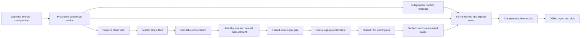

# Architecture and evidence boundaries

I use DriveCheck to examine how synthetic sensor faults change a passive collision-warning rule. The CPU workflow keeps prescribed vehicle motion, sensor observations, algorithm decisions and offline evaluation separate. Warnings do not brake either vehicle or change the trajectory.

This document describes the implementation accepted through C1 on 5 November 2026. Implementation and documentation were developed with AI-assisted teaching, review and explicitly delegated assistant work. Technical acceptance does not establish my independent understanding. The measured findings are in [results](results.md), the detailed investigation is in [C1 investigation](c1-investigation.md), and tested commands are in [reproduction](reproduction.md).

## Data flow



Truth reaches the evaluator through the lower path. The warning path receives arrived observations and the current decision time; it receives no future trajectory or contact label. Measurement generation can inspect clean truth because it constructs the experiment's sensor input, before causal replay begins.

## Modules and responsibilities

| Layer | Actual source | Responsibility |
| --- | --- | --- |
| Motion and references | [motion.py](../motion.py), [scenarios.py](../scenarios.py), [stop_and_go.py](../stop_and_go.py) | Piecewise continuous kinematics, sampled truth, continuous contact solvers and separately specified analytic fixture answers |
| Observation and faults | [observations.py](../observations.py), [faults.py](../faults.py) | Immutable readings, timestamp/stream validation, seeded noise, latency and dropout, with one audit row per source sample |
| Causal replay | [replay.py](../replay.py) | Decision clock, arrival queue, newest measured source, old-arrival and beyond-horizon counts |
| Warning policy | [warning_policy.py](../warning_policy.py) | Common availability/age gate and time-to-collision (TTC) branches; raw remains the default |
| C1 alternative | [c1_estimators.py](../c1_estimators.py), [c1_replay.py](../c1_replay.py) | Raw or constant-closing-speed age projection; retain original source, estimate and used decision separately |
| Offline evaluation | [evaluation.py](../evaluation.py) | Independent-event matching, exclusive positive outcomes, negative warning episodes and current-time errors |
| CPU release | [release_config.py](../release_config.py), [release_runner.py](../release_runner.py), [release_report.py](../release_report.py), [drivecheck.py](../drivecheck.py) | Validate/enumerate the M4 matrix, retain failures, write machine evidence and package a readable local report |
| Paired comparison | [c1_comparison.py](../c1_comparison.py), [c1_report.py](../c1_report.py), [c1_compare.py](../c1_compare.py) | Freeze separate splits, run both methods on the same inputs, retain every method record and render paired findings |
| Verification and reproduction | [tools/verify_c1.py](../tools/verify_c1.py), [tools/reproduce.py](../tools/reproduce.py), [tools/reproduce_c1.py](../tools/reproduce_c1.py) | Recompute saved evidence, check inventories/identities and reproduce from copied source in a new hash-locked environment |

Earlier entry points remain in the repository for the learning progression. [m1.py](../m1.py) exports checked truth fixtures; [experiments.py](../experiments.py) and [reporting.py](../reporting.py) support the earlier M2 slice; [m3_study.py](../m3_study.py) and [m3_regression.py](../m3_regression.py) supply study helpers and the preserved delay regression. The current release/comparison commands use the entry points above.

## Units, geometry and clocks

All model quantities use seconds, metres, metres per second and metres per second squared. Positive x points forward. Gap is `lead_rear_x_m - ego_front_x_m`; positive means separation, zero means touching, and negative means virtual overlap. Closing speed is `ego_speed_mps - lead_speed_mps`, so positive means the gap is shrinking under the current speeds.

The ego follows prescribed constant-speed motion. The lead-braking family cruises, brakes without reversing, then remains stopped. The stop-and-go family brakes, holds, restarts with acceleration, then cruises. Paths continue after first contact to preserve the stated full-horizon evaluation convention; this is kinematics, with no simulated impact response.

Samples have contiguous IDs beginning at zero and times `sample_id * timestep_s`. The inclusive horizon is `(sample_count - 1) * timestep_s`. Continuous state evaluators can also supply truth between samples, including at an arrival-time decision.

| Record | Fields and meaning |
| --- | --- |
| `TruthSample` | `scenario_id`, `sample_id`, `time_s`, `ego_front_x_m`, `lead_rear_x_m`, `ego_speed_mps`, `lead_speed_mps`, `gap_m`, `closing_speed_mps` |
| `Observation` | `scenario_id`, `sample_id`, `measurement_time_s`, `arrival_time_s`, `gap_m`, `closing_speed_mps`; arrival is the earliest availability time |
| `Decision` | `decision_time_s`, selected source ID/timestamps/age, used gap/closing speed, optional `ttc_s`, `is_warning`, `reason` |
| `StateEstimate` | Original immutable `source`, `estimate_time_s`, used `gap_m` and `closing_speed_mps`; age remains estimate time minus original measurement time |
| `DecisionRecord` | `source`, optional `estimate`, and `decision`; raw measurement values remain distinguishable from projected/used values |

Observation validation rejects non-finite values, arrival before measurement, wrong scenario identity, duplicate sample IDs/times and measurements outside the horizon. Missing IDs are permitted because dropout can omit readings. An arrival after the horizon remains valid evidence and is counted without being released early. Signed gaps and closing speeds remain signed.

The main decision clock is the sorted union of source sample times, arrivals inside the horizon, zero and the horizon. The five fixed-delay diagnostics use a separate 0.5 s clock. At each decision, replay processes every arrival with `arrival_time_s <= decision_time_s`, ordered by arrival time then sample ID. The selected reading is the one with the newest measurement time seen so far. An older reading arriving later cannot replace it; replay counts that ignored arrival.

## Faults and warning decisions

[FaultConfig](../faults.py) permits clean data or one fault type at a time. Noise adds independent Gaussian perturbations to gap and closing speed. Latency uses `base_delay + jitter * U`, where `U` is uniform on `[0, 1)`; the jitter is an additional nonnegative delay. Dropout suppresses a reading when a uniform draw is below the configured probability. Missing data never becomes a zero-gap reading.

Four private random streams use the configured gap, closing-speed, latency and dropout seeds. Injection reserves all four draws for every source row, even if a particular fault does not use a draw or a reading is dropped. The audit retains draws, errors, delay and dropout decisions. Clean truth is unchanged.

The common policy first checks the selected source. No source gives `unavailable` with no warning. A source is stale when `decision_time_s - measurement_time_s > max_age_s`; equality remains eligible. Stale decisions retain diagnostic source metadata/values but do not emit a warning or a C1 estimate. Projection cannot reset the source age or recover an unarrived reading.

For an eligible state the common TTC rule is:

| State | TTC and decision |
| --- | --- |
| Gap `<= 0` | TTC 0 s; warning with `contact_or_overlap`, checked before the closing-speed branch |
| Positive gap, closing speed `<= 0` | No finite TTC (`None`); no warning, `not_closing` |
| Positive gap and closing speed | `ttc_s = gap_m / closing_speed_mps`; warning when TTC is at or below the threshold |

Raw uses the held measurement. Age projection changes only the used gap:

```text
source_age_s = decision_time_s - measurement_time_s
estimated_gap_m = measured_gap_m - measured_closing_speed_mps * source_age_s
```

Closing speed, source timestamps, eligibility, queue and TTC branches stay shared. This is constant-closing-speed extrapolation with no tuning parameters. Braking, acceleration or noisy speed can violate its assumption; projection can amplify speed error by age.

For example, in `diagnostic-005`, at 4 s a reading measured at 1 s and delivered at 3.5 s reports 25 m and 5 m/s. Its age is 3 s. Raw TTC is 5 s; projection uses 10 m and TTC 2 s. With that diagnostic's fixed 2 s threshold, projection warns without receiving future data. The [results](results.md) show why this successful mechanism check does not settle the evaluation comparison.

## Independent references and scoring

Reference contact is the first continuous time at which bumper gap reaches zero within the inclusive horizon. Solvers search motion phases separated by braking/stop or stop/restart/cruise boundaries, using phase equations and a roundoff-sized endpoint allowance. A first sampled non-positive gap is not substituted for the continuous event time. Initial touching/overlap gives an event at zero.

Fixture answers are specified separately from the warning rule and checked before warnings run. For the original braking-contact fixture, the braking-phase equation is `gap(t) = 27.5 - 2.5*t^2`, giving contact at `sqrt(11)` s. The original stop-and-go contact fixture has restart gap `(u-1)*(u-3)` with `u=t-4`, giving first contact at 5 s even though the final 8 s gap is positive again. Final gap alone cannot classify that episode.

For a positive episode with event time `e`, scoring searches warning decisions in `[max(0, e-window), e]`. The earliest matched warning determines lead `e-warning_time`:

- **Useful:** a matched warning has lead at least the configured minimum.
- **Late:** a matched warning has smaller lead, including a warning exactly at contact.
- **Missed:** no warning is matched inside the pre-event window; early-only and post-contact-only warnings cannot rescue the event.

These positive categories are exclusive. Early and post-contact warning decisions are also counted explicitly. Consecutive true decisions count as one activation. For a negative episode, any warning yields one `false_warning` episode; otherwise it is `clear_negative`. A negative means no reference contact during its declared horizon, with no claim of permanent safety.

The main policy uses TTC threshold 3 s, maximum source age 1.25 s, pre-event window 4 s and minimum useful lead 1 s. Diagnostic settings are threshold 2 s, age 3 s, window 3 s and useful lead 1 s. These are experimental conventions, with separate result denominators.

`aligned_errors` compares the numeric state used by each eligible decision with clean truth at that same decision time. Gap mean absolute error (MAE) is in metres; closing-speed MAE is in m/s. Each eligible row has equal weight over the full horizon, including virtual post-contact paths. This is not time-weighted error. Unavailable/stale rows are counted and excluded; no eligible rows gives null MAE. Their absence is never treated as zero error.

## Paired experiments and saved evidence

[The C1 configuration](../configs/c1-comparison.json) selects the unchanged [M4 configuration](../configs/m4-release.json), separate development/evaluation seed bases and an evaluation similarity transform. Physical/reference checks run before method execution. C1 writes configuration, the full case plan and frozen selection/source identities before outcomes.

Each pair generates truth, observations, fault audit and decision clock once. Both methods reuse the exact same inputs and scoring policy; identities are checked before/after execution. The raw adapter must also match the original raw replay. A method failure remains a failed record with an error; one surviving method makes the pair partial. A completed algorithm miss remains a valid completed experiment.

The C1 output root contains:

```text
configuration.json       frozen-selection.json     case-plan.json
manifest.json            summary.json              cases.csv
report-manifest.json
cases/<case-id>/
    truth.csv            observations.csv           audit.json
    clock.json           metrics.json
    raw-decisions.csv    raw-records.json
    age_projection-decisions.csv
    age_projection-records.json
report/
    report.html          pair-01.png                pair-02.png
    pair-03.png
```

Machine evidence and rendering have separate manifests. [The C1 verifier](../tools/verify_c1.py) checks the planned inventory, hashes, physical/reference/fault arithmetic, causal source selection, estimates/TTC and recomputed scores/errors. A changed CSV with a newly computed hash can still fail the semantic audit. [The reproduction wrapper](../tools/reproduce_c1.py) checks a copied-source/new-environment run separately from hosted CI. See [reproduction](reproduction.md) for exact commands and the recorded platform boundary.

Generated evidence lives under ignored `outputs/`; a repository visitor regenerates it from the portable commands rather than relying on my local output folders. The CPU tool needs no CARLA, vehicle connection, credentials, paid service or hosted report. The supported conclusions remain limited to this prescribed one-dimensional synthetic experiment.
