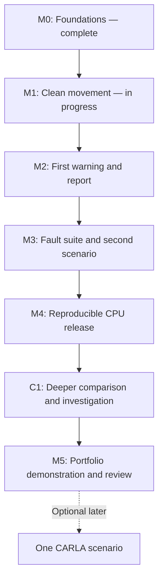

# My DriveCheck skills and delivery roadmap

Workflow correction, 2026-10-27: I want complete, study-ready milestone lessons prepared up front in separate chats, so I can follow them and implement the project at my own pace. Each lesson supplies the explanations, worked examples, code guidance, exact commands, expected results, debugging help and self-checks needed for its whole section. I can ask for help when needed, without waiting for another assistant reply after each small step. My assistant prepares the lessons and maintains README/docs; it does not autonomously implement the product or run ahead into later milestones. Git/publication remains my responsibility.

Earlier on 2026-10-27, my assistant interpreted the larger-block request as permission to implement complete milestones. That interpretation was mistaken and is superseded by the clarification above. Additional M1 code, dependencies and plots created during that work are preserved as assistant-created reference material. Their existence or assistant verification does not establish my implementation, reproduction, understanding or M1 completion. The learning topics, scope and estimates below are unchanged.

Prepared 2026-10-25; workflow corrected 2026-10-27. Current learner snapshot: **M0 complete; M1's first time-sampling table is implemented, learner-run and saved as a reviewed CSV snapshot. Further M1 learner work and understanding remain pending; later assistant-created artifacts are reference material.** Read `progress.md` and inspect actual files for the latest state. This is a learning plan, not evidence that later topics have been learned or that assistant-created features are learner-completed work.

My goal is a standout student portfolio project: a reproducible validation workbench, an original failure investigation, one fair comparison, and a demonstration I can explain and modify myself. The CPU release is a finished intermediate product. "Standout" is a quality target, not an achieved applicant ranking or promised employer response. CARLA remains optional.

**My starting evidence**

The Python 3.14.7 project environment exists. I completed `motion.py` and one standard-library `unittest` using teaching templates. The fixture starts at a 30 m gap with ego at 20 m/s and lead at 15 m/s; after 2 s it returns 20 m. I ran the script/test, explained why the gap shrinks and saved the independent expected-value correction. My assistant reviewed the files and verified a script run and one passing test. Broader numerical, testing and environment mastery is unassessed. Git had not been initialized and no third-party project packages were installed at that reviewed foundation checkpoint; later assistant-created M1 reference work added dependencies. For M1, I completed the guided loop/function call and supplied the five rows for 0–4 s with gaps 30, 25, 20, 15 and 10 m, plus the unchanged one-case unittest `OK` in 0.001 s. My assistant reviewed the saved source. I then ran the supplied PowerShell save/read-back block; my output and the assistant's direct file read confirm `outputs/constant_speed.csv` contains the header and those five rows. This is guided implementation/run/file evidence; my independent 3-second hand calculation and explanation of sampling are still pending. Current source may also contain later assistant-created reference work; attribute it separately from this reviewed learner baseline.

**How my skills develop**

For each complete milestone lesson: explanation and worked example → my implementation at my own pace → local run and self-check → small independent transfer task → optional review/help in that milestone chat. The full lesson is available before I start; checks are exercises with supplied guidance, not mandatory chat reply gates. Each new concept supports the current build. I do not need to complete a separate Python or mathematics course first.

| Skill | Evidence I have now | Progression through the project | End-of-project demonstration |
| --- | --- | --- | --- |
| Python construction | One function/test completed with templates; guided sampling loop/call and learner-run output reviewed; sampling explanation pending | Loops/time samples → records/files → validation → small modules → stateful replay → command-line interface | Implement and explain a small new requirement |
| Mathematical modelling | Correct constant-speed result and qualitative closing-speed explanation | Units/signs → sampled time → acceleration/braking → contact/horizon → timing/TTC → noise and estimator prerequisites | Independently check an event and explain assumptions |
| Testing and debugging | One independently calculated expected answer; saved correction verified | Boundary cases → timing/metric fixtures → integration checks → reproducible diagnosis → regression tests | Diagnose a new failure and add a useful regression check |
| Data and experiments | Guided five-row table and first CSV snapshot reviewed; hand check and data contract pending | Inspectable tables → labelled plots → causal readings → controlled faults → complete results → fair comparisons | Reproduce and interpret a result with denominators and trade-offs |
| Tools and reproducibility | Environment and script/test commands verified; supplied PowerShell save/read-back block learner-run and saved file reviewed; Git pending | User-run Git → dependencies when needed → saved settings/seeds → CLI → clean-environment reproduction → actual CI | Run the documented workflow and distinguish local/remote evidence |
| Engineering explanation | Qualitative explanation of shrinking gap | Explain assumptions → trace a warning → justify a policy → diagnose a failure → defend a comparison | Give a short demo and make a small independent change |

The local evidence tracker is `../.private/skill-progress.md`. It distinguishes introduced concepts, use with support, demonstrated bounded tasks and independent transfer. A single successful task does not establish broad mastery.

**Delivery sequence**

C1 is only a label for the already-planned deeper comparison, not another extension. One focused chat per checkpoint holds its complete study-ready lesson and can span several sessions. All remaining lessons can be prepared up front; my implementation follows the dependency order M1 → M2 → M3 → M4 → C1 → M5. Preparing a later lesson does not authorize implementing that section. Tests and documentation grow as I work through the lessons.

**M0 — Foundations: complete within its bounded scope**

- Practised: folder navigation, use of the project interpreter, function calls, script/test commands, fixed expected answers and a qualitative physical explanation.
- Evidence: my saved calculation/test, learner-run output and explanation, correction and final assistant verification.
- Still to practise: imports/assertions/main guard more deeply, broader cases, environment understanding and user-run Git. Do not recreate setup or repeat the completed exercise.

**M1 — Clean movement: turn one calculation into trajectories**

Learning and build slices:

1. Explain sample index, elapsed time and interval. The guided five-row time/gap table for 0–4 s is implemented and learner-run; my saved code/output and first CSV snapshot have been reviewed. The 2026-10-26 larger-block preference is now delivered through one complete study-ready M1 lesson, including the worked physical check, data contract, sampler/export and changed-timestep test. I work through it without an arithmetic reply gate; explanations and meaningful attempts remain evidence to review when supplied.
2. Define the smallest clean-data contract: forward axis, bumper gap, time/sample IDs, units, scenario/configuration and declared horizon. Start with simple records; freeze the contract after an inspectable slice works.
3. Introduce acceleration and piecewise braking. Build one analytic lead-braking/contact fixture and one independently checked non-contact fixture. Define what happens when a braking vehicle reaches zero speed so it does not accidentally reverse.
4. Define contact/overlap and crossing between samples. Check the reference event time analytically; the first sampled non-positive gap is not automatically the exact event time. State timestep and numerical tolerances.
5. Save an inspectable CSV and plot time/gap with units and event/horizon markers. My first two-column constant-speed CSV snapshot is already saved and reviewed. Fuller M1 artifacts created by the assistant are preserved reference material; my own implementation/reproduction and explanation of that work remain pending. The lesson explains the plotting dependency, relevant compatibility/licence/version checks and any setup already performed, so I do not blindly repeat it.

- Product evidence: clean saved trajectories, contact/non-contact fixtures, labelled plot and independent known-answer tests.
- Learner completion evidence: I explain a changed speed/timestep case and independently check a value/event. Repeating the implementation's formula inside a test is not independent evidence. This is checked through the lesson's self-checks and any later submitted work, without blocking access to the rest of the lesson.
- Work style: one complete lesson up front, with guided sections, worked checks and meaningful learner attempts at my pace.
- Initial allowance: 3–4 focused hours; revise if contact modelling or plotting needs more teaching time.

**M2 — First demonstration: causal readings and warnings**

1. Separate truth from sensor readings. Define measurement time, arrival/availability time and observation age before delay. The warning program can only use arrived observations, never future truth.
2. Build sequential replay and trace a short timeline. Specify validation/ordering and unavailable/stale-reading policies.
3. Explain time to collision (TTC): positive gap divided by positive closing speed under unchanged speeds. Specify zero/negative closing speed, contact, missing and stale-data behaviour before implementing those branches. Choose a documented experimental warning threshold.
4. Define independent reference events and scoring before evaluating/tuning warnings: horizon, pre-event window, useful lead time, late/missed events, repeated warnings and negative episodes. Truth labels must not be generated by the same TTC threshold being tested.
5. Compare a small clean set with one controlled latency or noise condition on unchanged trajectories. Connect configuration → replay → warning → evaluator → small report.

- Product evidence: one documented command generates machine-readable results and a small readable report, including settings, plots, all cases and visible misses/late warnings/denominators.
- Learner completion evidence: I trace a reading through arrival, TTC, warning and scoring, and explain one changed outcome and limitation.
- Work style: one complete lesson up front, with guided implementation and a small learner change/diagnosis.
- Initial allowance: 4–5 hours. Timing/scoring are likely sources of extra learning time. This is the first end-to-end demonstration, not the complete release.

**M3 — Fault suite: systematic testing**

1. Learn distribution, units, severity, seed and reproducibility through a concrete noisy reading. Clean truth remains unchanged.
2. Add noise, latency and dropout separately. Deliberately check clean, low and stronger settings; record all settings, not only the seed. Combined faults remain later work unless justified.
3. Test arrival scheduling/order, availability boundaries, stale age, variable intervals, duplicates and invalid/non-finite values under the chosen policies. Missing data is distinct from zero gap.
4. Add stop-and-go as the second family, with independently checked contact/non-contact cases where appropriate.
5. Cover zero/negative closing speed, contact/zero gap and known-answer metric examples. Diagnose a fault-induced failure and preserve a regression case.

- Product evidence: three faults, two scenario families, reproducible causal replay and useful boundary/metric tests.
- Learner completion evidence: I implement or repair one bounded fault/test with hints and explain a reproduced failure using saved evidence.
- Work style: one complete lesson up front, with more learner attempts, worked debugging guidance and coaching available.
- Initial allowance: 4–6 hours.

**M4 — CPU release: usable, complete and reproducible**

1. Enumerate the experiment matrix: scenario/configuration, contact status, horizon, fault/severity and seeds. Include all results; label failed/partial runs explicitly.
2. Report missed events, false-warning episodes on negative episodes, earliest matched lead time, late warnings and aligned gap/closing-speed errors. Keep denominators, units and missing/stale treatment visible.
3. Finish a configuration-driven command-line interface with helpful errors, machine-readable results and a readable offline report. Generated HTML and local plots are the current reporting design target; no hosted service/CDN is needed.
4. Write the first evidence-backed failure study: question, setup, expected/observed behaviour, diagnosis, supporting plot/test and limitations. C1 later evaluates one alternative.
5. Teach Git in a bounded user-run block before publication/CI depends on it: inspect changes, choose files, understand staging/commits and ignored outputs. I retain control of staging/commits/pushes and remote/publication choices.
6. Record exact runtime/dependency versions and a minimal reproducible install/lock approach when external packages exist. Check transitive licences and actual installation support. `unittest` may remain; moving to pytest needs a practical reason.
7. Add meaningful lint/test continuous integration (CI) and an end-to-end fixture. Reproduce a report in a clean isolated environment from documented commands. Remote CI succeeds only after I choose to push and an actual run passes; pending remote evidence stays pending.

- Product evidence: full results/report, regression tests, failure study, clean-environment reproduction and release checks. Report local acceptance and remote CI status separately; the adopted brief's release checklist still applies.
- Learner completion evidence: I run the documented workflow and investigate a configuration/integration problem with coaching.
- Work style: one complete lesson up front, with learner-operated runs/debugging, explanation and optional review.
- Initial allowance: 5–7 hours.

**C1 — Deeper comparison: the main portfolio investigation**

1. Freeze a usable CPU baseline. Select one question from an observed failure and one bounded comparison method after primary-source due diligence and a prerequisite check.
2. A constant-velocity Kalman filter is a candidate. If selected, learn a state vector, matrix shapes, uncertainty/covariance, motion/measurement models and predict/update steps through a small numerical example before implementing it. Understand the noise assumptions and tuning choices.
3. Add the alternative as a small replaceable component. Hold causal observations, warning policy, scenarios and fault settings fixed; use actual elapsed intervals.
4. Separate development/tuning cases from final evaluation cases/seeds. Compare misses, false warnings, late warnings, lead times and estimation errors, including denominators and variation where informative.
5. Deepen the case study with successes, losses and unchanged cases, a regression case and limitations. No measured improvement is required. A few synthetic cases do not establish generalisation or real-world safety.

- Product evidence: reproducible baseline-versus-alternative report and one original investigation supported by code/data/tests.
- Learner completion evidence: I explain the mechanism, an assumption and a measured trade-off, and reproduce the comparison.
- Work style: one complete lesson up front, with a worked example, prerequisite self-check, bounded learner implementation/debugging and interpretation. Selection of the actual comparison still depends on the implemented baseline, observed failure and readiness; lesson preparation does not invent those findings.
- Initial allowance: 8–12 hours only if prerequisites are manageable. If substantial additional teaching is needed, explain/re-estimate before proceeding. Choose a smaller defensible comparison if appropriate; do not silently add algorithms.

**M5 — Portfolio finish: explain and defend the work**

1. Simplify confusing code/docs and finish the README, architecture explanation, reproduction instructions, case study, result table and limitations.
2. Prepare a 2–3-minute demonstration covering the question, experiment, failure, comparison and supported conclusion.
3. Reproduce a saved experiment and make one small independent modification with predicted behaviour and a meaningful check.
4. Review implemented/planned claims, source/licence attribution and honest AI assistance. Keep private learning/context files out of public material. I control publication.

- Product evidence: a clear portfolio presentation and short reproducible demo.
- Learner completion evidence: I explain how an event was checked, how delay is handled, what a test establishes, a design trade-off and a model limitation.
- Work style: one complete lesson up front, with a portfolio checklist and self-guided demonstration/reproduction exercises.
- Initial allowance: 2–3 hours if documentation has grown throughout; re-estimate a larger rewrite.

**Optional later work**

One CARLA import is outside the schedule below. Check matching release/hardware/Python requirements and setup cost first; the brief allows 8–15 hours plus setup uncertainty. A 3D clip alone is not validation evidence. Interactive report navigation is useful only if it clarifies an existing finding. Extra scenarios, UI frameworks and algorithms are not hidden requirements.

**Effort and pace**

| Remaining checkpoint | Initial focused hours |
| --- | ---: |
| M1 | 3–4 |
| M2 | 4–5 |
| M3 | 4–6 |
| M4 | 5–7 |
| C1 | 8–12 |
| M5 | 2–3 |
| Work before buffer | 26–37 |
| Separate consolidation/debugging buffer | 6–10 |
| Planning range including buffer | 32–47 |

These are estimates for my learning/build work in the remaining phases, not measured remaining time or a schedule for autonomous assistant implementation. M1's opening implementation/run/CSV slice is reviewed, while the hand check and broader learner milestone remain; actual focused time is unreported. Preserved assistant-created reference artifacts do not deduct unmeasured learner effort from these estimates. At a tentative 90 minutes per working day, 32–47 hours is roughly 22–32 full working blocks. Calendar duration depends on attendance and difficulty. The first small M2 demonstration is roughly 7–9 planned hours beyond M0. Re-estimate after M1's first two working sessions using actual focused time if available; never infer study time from chat elapsed time.

A flexible 90-minute block could use 15 minutes for explanation, 45 for building, 20 for running/debugging/interpretation and 10 for recap/documentation. Adjust to the task; coherent chunks can span sessions. I run setup/walkthrough commands unless I ask my assistant to run them. No mandatory reply after every command or continuous quizzes.

If a feature estimate doubles, inspect the cause and agree a smaller next slice. If no end-to-end output exists after about 8–10 total focused project hours, simplify toward the smallest truthful replay/report. Defer optional visuals/simulator work/extra algorithms before sacrificing tests, causality, reproducibility or understanding.

**Documentation and checkpoint ownership**

My assistant maintains documentation from my point of view using actual decisions, observed work and my explanations. It identifies assistant-run actions accurately, distinguishes planned/completed features and attributes assistance honestly. Personal reflections require my own input; public technical material stays separate from private learning/context records.

Update the current progress, local skill evidence, material checkpoint log and next-chat handoff at coherent boundaries. Every reply reports concrete current-checkpoint progress; no invented mastery or completion percentage. New milestone chats read shared files and inspect current work. Record lesson delivery, assistant-created reference artifacts, learner implementation/runs and demonstrated understanding separately. This plan authorizes complete lesson preparation, not automatic product implementation.

**My immediate task**

My assistant prepares the complete study-ready M1 lesson in its focused chat and the remaining section lessons in their own chats. I then follow M1 at my own pace, starting from the reviewed table/CSV baseline, using the worked physical check and building through the clean-data contract, braking/contact/non-contact cases, tests and plot. Existing assistant-created M1 artifacts are preserved and clearly labelled as reference; they do not replace my pending work or establish completion. I can ask for help or submit work for review when useful, without waiting for a reply to unlock each block. This coordination work changes lessons/docs only.
