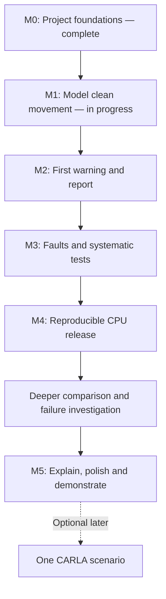

# My DriveCheck learning progression

Workflow correction, 2026-10-27: I want complete study-ready lessons up front, one separate chat for each remaining section, so I can implement and study at my own pace. My assistant provides the full explanations, worked examples, implementation guidance, commands, expected results, debugging help and self-checks, and maintains documentation. I do not need to wait for replies between small steps. The roadmap's technical scope and effort estimates are unchanged.

The earlier 2026-10-27 interpretation that my assistant should implement/test whole milestones was mistaken and is superseded. M1 code, dependencies and plots created during that work are preserved as assistant-created reference material; they do not establish my implementation, reproduction or understanding. Further autonomous product implementation is stopped while the chats prepare lessons.

My goal is a finished student engineering portfolio project with reproducible results, an original failure investigation, a fair comparison, and a short demonstration I can explain and modify myself. "Standout" is the quality target, not a verified ranking or promised employer response. M0 foundations was completed on 2026-10-25. My reviewed M1 learner evidence is the first five-row constant-speed table and CSV snapshot saved through the supplied PowerShell block. The independent 3-second hand check and sampling explanation are pending. My own work through the clean-data contract, braking/contact/non-contact fixtures and plot remains pending, separately from the preserved assistant-created reference artifacts. Later learner milestones remain planned.

The first CPU release gives me a working foundation. The portfolio target includes one deeper comparison before final presentation. A state estimator is a candidate for that comparison; the choice depends on the concepts I have learned, available time, and bounded technical checks. CARLA remains an optional later addition.

| Stage | What I learn | Evidence I can produce or explain | Initial focused hours |
| --- | --- | --- | --- |
| M0 — Foundations | Project folders, terminal commands, isolated Python environment, tests, basic Git workflow | Run a script and test; explain their output | 2–3 |
| M1 — Clean movement | Units, position, relative speed, time steps, clean reference trajectories | Match hand-calculated gap/contact values to saved data and a plot | 3–4 |
| M2 — First demonstration | Sensor readings versus truth, measurement versus arrival time, time to collision, independent reference events and scoring | One command produces a small report; trace how available readings caused a warning | 4–5 |
| M3 — Fault suite | Noise, latency, missing readings, boundary cases, reproducibility | Replay both scenario families and reproduce a fault-induced failure; explain a tested edge case | 4–6 |
| M4 — CPU release | Experiment design, result tables, packaging, automated checks and continuous integration | Reproduce complete case results from saved settings; meaningful checks pass. Remote CI is only verified after my own push and an actual run | 5–7 |
| Deeper comparison | A second approach, its prerequisites, fair comparisons and trade-offs | Compare against the original method on the same observation streams and separate evaluation cases; report wins, losses, misses and limitations | 8–12, provisional |
| M5 — Portfolio finish | Technical writing, design justification, demonstration and review | Explain one investigation, demonstrate the tool in 2–3 minutes, and make a small independent modification | 2–3 |

M0 completion evidence: Python 3.14.7 project environment, learner-written gap calculation and known-answer test, learner-run script/test output, a qualitative closing-speed explanation, and a saved test correction confirmed by an assistant verification run. That learner evidence covers one constant-speed fixture; later assistant-created reference tests/artifacts do not extend it. No learner Git initialization has been recorded; basic Git practice remains a future learner-run work chunk. These observations do not establish mastery of every topic listed in the learning column. Actual focused time was not reported, so the hour estimates have not been calibrated from this session.

The original M0–M5 core estimate is 20–28 focused hours. Including a deeper comparison gives 28–40 hours before buffer. These are hypotheses to revise after the first two working sessions. Learning, debugging, testing and documentation all count. No fixed calendar commitment has been made.

## How I progress

For the expanded skill progression, coherent work slices, checkpoint evidence and remaining effort estimates, see [my detailed roadmap](detailed-roadmap.md). My local reviewed skill evidence is in `.private/skill-progress.md` at the project root. The current snapshot in `progress.md` remains authoritative.

Complete milestone lesson available → study the explanation/worked example → implement at my pace → run and self-check → interpret the result → optionally ask for review/help → update the checkpoint from supplied evidence.

All remaining lessons can be prepared up front, while my implementation follows M1 → M2 → M3 → M4 → C1 → M5. Each lesson includes prerequisites, complete coherent blocks, expected outputs, common errors, exercises and worked self-checks; later empirical choices are labelled conditional on actual earlier results. Checks do not require a chat reply to unlock the next block. Tests and documentation grow with my work. Independent reference events and scoring are defined before evaluating or tuning warnings. Learner completion requires runnable evidence and an explanation of the current piece; passing assistant-generated tests alone does not establish understanding. A comparison with no measured improvement can still provide a credible engineering finding.

## Documentation ownership

My assistant maintains the project documentation from my point of view, based on my actual choices, observed work, and explanations. The documents distinguish lessons delivered, planned features, assistant-created reference artifacts and learner-completed work; they record assistant-run actions accurately and attribute assistance honestly. Existing reference artifacts are preserved rather than silently removed or credited to me. Personal reflections are only included when I have actually supplied them. The private handoff and local learning notes stay separate from public technical materials.
