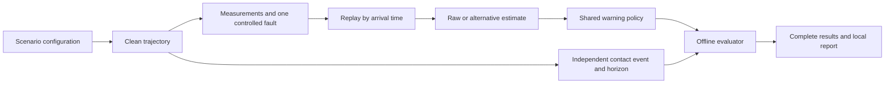

# M5 — Explain the evidence, finish the portfolio, rehearse the demo

**Lesson prepared 27 October 2026. Status: study material ready; learner implementation, runs, review and demonstration pending.**

This is a complete lesson to follow at your own pace. Read a block, do its work, inspect the checks and continue. You do not need to send a reply between commands. Bring back the saved files, outputs or a specific difficulty when you want review.

The clarification in [the study guide](../study-guide.md) governs this lesson: the assistant prepares the material; you build and run the project. Earlier assistant-created M1 code, plots and dependency files are preserved reference material. Their presence does not establish that you implemented or understand M1. No product command was run, dependency installed or product file changed to prepare this lesson.

## Before doing M5

You can read this lesson now. Do the release and demonstration work after you have implemented the CPU core through M4 and the bounded C1 comparison, with saved evidence. In particular, you need:

- Clean truth and independently checked contact/non-contact events for the two scenario families.
- Causal observations, warning decisions, the three separate fault types and a stated scoring policy.
- A complete experiment report, configurations/seeds, local tests, a reproduced environment and one investigated failure.
- A C1 baseline-versus-alternative result on the same observations and policies, with development/tuning cases separate from evaluation cases. The alternative need not win.

At authoring time the inspected reference files include `motion.py`, `scenarios.py`, `m1.py`, `configs/m1-fixtures.json` and M1 export artifacts. The later module names below are **proposed curriculum interfaces**, not claims that the CPU core or comparison exists. Recheck your implemented M4/C1 commands before putting them in a public README.

M5's result is a clear, reproducible explanation of the work you actually have. It adds no new estimator, simulator, hosted website or dashboard framework. CARLA remains optional later work. Git actions, remote CI and publication remain your decisions and actions.

## The work blocks and files

Work through these blocks in order; spread them across sessions if useful. The original 2–3-hour M5 allowance assumes earlier sections already contain good evidence and notes. It is an estimate, not a measured completion time. Reproduction or interpretation problems belong to the relevant earlier section and can take additional time.

| Block | What you finish | Evidence you keep |
| --- | --- | --- |
| 1. Audit the story | Claims connected to actual files and runs | A short claim/evidence table |
| 2. Explain the architecture | Truth, observations, decisions and scoring traced separately | One diagram and a worked timeline |
| 3. Present results honestly | Complete denominators, failure and comparison explanation | A checked results table and evidence links |
| 4. Write and simplify | A useful README and focused supporting documents | Reviewed prose; one bounded cleanup if needed |
| 5. Reproduce and rehearse | An offline artifact set and a 2–3-minute demonstration | Exact commands, run identity and rehearsal notes |
| 6. Explain and change | Your own explanation and a predicted independent change | Prediction, modification, check and interpretation |
| 7. Review release materials | Attribution, licences, privacy and explicit remaining gates | A local review record and your release decision |

Suggested file responsibilities **when you carry out M5**, not files created by this lesson:

| File | Responsibility |
| --- | --- |
| `README.md` | Short entry point: question, actual capability, quick reproduction, principal finding, limits and links |
| `docs/architecture.md` | Module responsibilities, units, data contracts, causal boundary and one trace |
| `docs/reproduce.md` | Tested setup/run commands, configuration paths, expected artifacts, runtime and verification |
| `docs/results.md` | Complete results or a link to the complete machine-readable table, summary with denominators and comparison interpretation |
| `docs/failure-study.md` | Question, fixed setup, observed failure, diagnosis, evidence, regression check, comparison and limitations |
| `docs/demo.md` | Your exact rehearsal commands, screen order, spoken script and recovery notes |
| `THIRD_PARTY_NOTICES.md` | Reused software/assets/code, exact versions and required notices or notice locations |
| `LICENSE` | The project licence you choose, after reviewing what you are entitled to license |
| `outputs/m5/<run-name>/` | Ignored, generated local demonstration artifacts and evidence records |

Reuse an existing document that already has the right responsibility. Do not create two competing versions of the same result. The table is a small filing convention, not a reason to split every paragraph into a new file. Private learning records, handoffs and personal reflections stay out of the technical release.

## Block 1 — Turn a portfolio claim into something a reader can check

A portfolio claim is a sentence plus its evidence. “Reproducible” needs a configuration, source/version identity, command and inspected output. “Handles delayed readings” needs a causal trace or test; a clean gap plot cannot establish it. “I understand the method” needs your explanation or independent work; a generated test suite cannot establish that.

Start from the completed project, not the roadmap. Read your actual entry point, configuration, saved manifest/results, tests and C1 report. Make this small table in your working notes:

| Claim | Minimum useful evidence | Wording if evidence is missing |
| --- | --- | --- |
| The model finds contact between saved samples | Independent analytic event and a boundary test | “Contact-event checking is planned” |
| A delayed sample is unavailable before arrival | Replay trace and an arrival-boundary test | “Latency semantics remain unverified” |
| The local report reproduces | Exact successful command, saved config and comparison of repeat outputs | “Reproduction has not yet been checked” |
| The alternative changes warning outcomes | Paired evaluation rows on identical observation streams | “Comparison pending” |
| Remote CI passed | Actual remote run tied to the tested revision | “Local checks passed; remote CI pending” |
| I made a small independent change | Your prior prediction, saved change, meaningful check and explanation | “Independent modification pending” |

**Worked evidence sentence from the M1 reference.** The contact fixture uses a 30 m gap, ego speed 20 m/s, lead speed 15 m/s, braking from 1 s at a deceleration magnitude of 5 m/s² and a 5 s horizon. During braking:

`ego_front_x_m = 20t`

`lead_rear_x_m = 30 + 15t - 2.5(t - 1)²`

Equating the bumpers gives `27.5 - 2.5t² = 0`, hence contact at `sqrt(11) = 3.3166247903554 s`. This falls between braking start at 1 s and lead stop at 4 s, so that equation applies. The saved rows at 3 s and 4 s have gaps 5 m and −12.5 m respectively. The first nonpositive row is 4 s; it is not the exact contact time.

A supported sentence after you reproduce/check it is: “For this analytic fixture, the contact solver matches the independently derived 3.3166247903554 s event; the first sampled nonpositive gap is at 4 s.” That establishes a bounded event check. It does not establish realistic impact physics, all-scenario correctness or warning safety.

Your task is to choose five important claims in your current README/report and attach an exact artifact, configuration and test/run to each. Remove or qualify any claim you cannot support. Preserve failed and partial cases in the evidence set. An attractive screenshot is not a substitute for the complete results.

**Check:** another reader should be able to follow each evidence reference without your private chat history. Public documents must not depend on `.private/`, `AGENTS.md` or `docs/progress.md`.

## Block 2 — Explain the architecture through one reading

The architecture matters because it protects the experiment. The algorithm is being evaluated against information it could not know at decision time. Keeping that boundary explicit prevents accidental access to future truth.

Use the shared curriculum contracts when you implement and document the later modules:

| Responsibility | Interface to explain | What must stay separate |
| --- | --- | --- |
| Existing M1 reference: `motion.py`, `scenarios.py` | `Scenario`, `TruthSample`, `sample_truth`, `first_contact_time`; independent fixture answers | Clean trajectories are not noisy measurements |
| Proposed `observations.py` | `Observation(scenario_id, sample_id, measurement_time_s, arrival_time_s, gap_m, closing_speed_mps)` | Fault settings/seeds recorded; dropout omits a reading rather than creating zero gap |
| Proposed `replay.py` | Release only readings with `arrival_time_s <= decision_time_s`; order by arrival then sample ID | Future arrivals must remain unavailable; measurement ordering/staleness needs an explicit policy |
| Proposed `warning_policy.py` | Decision fields: `decision_time_s`, `measurement_time_s`, `observation_age_s`, `ttc_s`, `is_warning`, `reason` | Current decision receives arrived observations and time, not future truth/contact labels |
| Proposed `evaluation.py` | Independent reference event, declared horizon, useful/late/missed and false-warning episode rules | A TTC threshold must not create its own reference labels |
| Proposed `experiments.py`, `reporting.py`, `drivecheck.py` | Enumerated cases and all saved statuses/results; CLI and offline report | A report cannot silently discard unsuccessful runs |
| C1 alternative | Replaceable estimate component receiving the same causal stream | Same warning/scoring policy, cases and faults; separate tuning/evaluation |

Keep the name `warning_policy.py`: naming your module `warnings.py` can shadow Python's standard-library `warnings` module. If your implemented names differ, update the diagram and text together.

The real M1 reference `TruthSample` fields are `scenario_id`, `sample_id`, `time_s`, `ego_front_x_m`, `lead_rear_x_m`, `ego_speed_mps`, `lead_speed_mps`, `gap_m`, `closing_speed_mps`. Time is seconds, positions/gap are metres and speeds are m/s. The forward axis is positive x; gap is lead rear minus ego front. Negative gap is virtual overlap in this kinematic model, not a simulated impact response.

You can put this compact diagram in `docs/architecture.md` after matching the labels to your code:



Explain the two paths into evaluation. The truth path supplies the independent event and error reference. The decision path supplies what the algorithm actually did with available data. There is no arrow carrying future contact from the evaluator into the warning rule.

### Worked trace: measurement time is not availability time

This is a hand-calculated teaching trace, **not a newly measured M2/C1 result**. Use the M1 contact trajectory above and imagine a reading measured at 2.0 s with 0.6 s latency:

| Item | Independently calculated value |
| --- | ---: |
| Measurement time | 2.0 s |
| Ego front at measurement time | 40 m |
| Lead rear at measurement time | 57.5 m |
| Measured gap in this noiseless example | 17.5 m |
| Ego/lead speed at measurement time | 20 / 10 m/s |
| Closing speed | 10 m/s |
| Arrival time | 2.6 s |
| Age at a 2.6 s decision | 0.6 s |
| Raw constant-speed TTC from that reading | `17.5 / 10 = 1.75 s` |

At a decision time of 2.5 s this reading cannot be used because it has not arrived. At 2.6 s it can be considered. A rule retaining the raw reading still has a gap measured at 2.0 s; it must not quietly label that gap as current ground truth at 2.6 s. A C1 method may explicitly estimate forward, but that is a separate assumption and computation.

Suppose, only for this trace, the experimental threshold is TTC at most 2 s, the maximum accepted age is 1 s, warnings from 3 s before contact up to contact are eligible, and useful lead time is at least 1 s. Then the reading can trigger at 2.6 s, but lead time against the independent contact is:

`3.3166247903554 - 2.6 = 0.7166247903554 s`.

That warning is late under this example policy. The raw TTC 1.75 s is a prediction under unchanged speeds, not the measured lead time. If maximum age were instead 0.5 s, this reading would be stale and should follow the declared stale-data policy. Neither numerical policy is a safety standard; your real report must use the policy implemented and frozen in M2/M4.

Your task is to trace one real saved reading through measurement, arrival, selection, age, TTC/estimate, decision and offline score. Add its scenario/case/sample IDs and the actual policy to `docs/architecture.md`. Explain what happens if the reading is missing or stale. The trace should be a few rows, not a dump of the whole log.

**Check:** calculate one lead time using the saved decision time, not the measurement time. Confirm a warning cannot use a sample before arrival. Check the documented equality at the arrival boundary against your test.

## Block 3 — Turn complete results into an honest conclusion

Your summary must answer “out of how many?” A false-warning episode rate uses negative/non-contact episodes as its denominator. A missed-event rate uses reference-contact episodes under your declared matching rule. A missing error estimate is not a zero error. A failed run is not a successful run with zero warnings.

Write down the actual scoring definitions before summarising. For example, some projects count a late warning separately from a missed event; others also count it as a failure of useful detection. Report both clearly if your convention does. Do not change M2/M4's frozen convention in M5 to make the headline better.

### Worked miniature: an alternative can improve one metric and lose another

The following eight episodes and two methods are **invented arithmetic fixtures for learning how to present results**. They are not DriveCheck benchmark results and must not be copied into the actual result section as measured evidence.

For this miniature only: each positive episode has one contact at 5 s, the matching window is `[2, 5] s`, useful lead is at least 1 s, `0 <= lead < 1` is late, and no eligible warning means missed. A negative episode has no contact in its declared horizon; any warning makes it a false-warning episode. Repeated warnings do not increase that episode count. Warning times here are decision times.

| Episode | Reference | Raw earliest eligible warning | Alternative earliest eligible warning |
| --- | --- | ---: | ---: |
| P1 | Contact at 5 s | 3.0 s | 2.5 s |
| P2 | Contact at 5 s | 3.5 s | 3.0 s |
| P3 | Contact at 5 s | 4.5 s | None |
| P4 | Contact at 5 s | None | None |
| N1 | No contact in horizon | Warning | Warning |
| N2 | No contact in horizon | Warning | None |
| N3 | No contact in horizon | None | None |
| N4 | No contact in horizon | None | None |

Calculate these before reading the answer:

1. Useful, late and missed counts for each method.
2. False-warning episode count/rate.
3. Mean lead among useful warnings and among all matched warnings, with sample counts.
4. One supported advantage and one supported disadvantage of the alternative.

<details>
<summary>Worked answer — check after calculating</summary>

| Metric | Raw | Alternative |
| --- | ---: | ---: |
| Contact episodes | 4 | 4 |
| Non-contact episodes | 4 | 4 |
| Useful warnings | 2/4 | 2/4 |
| Late warnings | 1/4 | 0/4 |
| Missed events under this convention | 1/4 = 25% | 2/4 = 50% |
| No useful warning: late plus missed | 2/4 = 50% | 2/4 = 50% |
| False-warning episodes | 2/4 = 50% | 1/4 = 25% |
| Mean useful-warning lead | `(2 + 1.5) / 2 = 1.75 s`, n=2 | `(2.5 + 2) / 2 = 2.25 s`, n=2 |
| Mean all-matched-warning lead | `(2 + 1.5 + 0.5) / 3 = 1.333… s`, n=3 | `(2.5 + 2) / 2 = 2.25 s`, n=2 |

The alternative has one fewer false-warning episode among four negatives, a decrease of 25 percentage points. It also has one more missed event among four positives, an increase of 25 percentage points. The disappearance of the late warning in P3 was a miss, not a successful conversion to an earlier warning. Mean matched lead improved while the set of detected events shrank. The useful-warning rate stayed 2/4.

A suitable conclusion is: “In this eight-episode arithmetic fixture, the alternative reduces false-warning episodes but misses one additional contact episode. It provides no increase in useful-warning count.” This fixture cannot establish statistical significance or real-world generalisation.

</details>

### Build your actual summary

Use the machine-readable result rows from M4/C1. At minimum retain these conceptual fields; map names explicitly if your implementation differs:

| Kind | Fields to retain |
| --- | --- |
| Identity/status | Case ID, scenario/family, algorithm, development/evaluation split, complete/failed/partial status and error |
| Experiment | Scenario configuration, horizon, fault kind/severity/units, seed, warning/scoring settings, source/configuration identity |
| Event outcome | Reference contact or none within horizon, useful/late/missed outcome, earliest eligible warning/lead, negative episode warning flag |
| Estimation error | Gap/closing-speed error, units, evaluation-time alignment, available estimate count and missing/stale treatment |
| Fairness | Observation-stream identity for each paired method; unchanged warning and scoring policy |

These are documentation requirements, not a new result JSON schema imposed on M4. Do not invent keys in the product to fit this lesson; add a small explicit mapping in your explanation if needed.

Make a table with method, successfully evaluated contact episodes, misses, late warnings, successfully evaluated negative episodes, false-warning episodes, lead-time summary with its sample count, error summaries with counts, and failed/partial runs. State the expected case count from the enumerated matrix and reconcile it with observed statuses. If a run failed before contact status was known, show it as an unscored failure rather than guessing its denominator. Break out family and fault/severity where that explains a trade-off. Keep a link to **every per-case row**, not only the demo cases.

If grouping across seeds, show the seed count and what an “episode” means. Repeated synthetic seeds are not automatically independent real-world trials. Pooling counts before division and averaging per-group rates can give different answers when group sizes differ; say which you used. For example, one false episode in two negatives and one in eight gives a pooled rate `2/10 = 20%`, while the unweighted average of `50%` and `12.5%` is `31.25%`. Use the pooled count for an overall episode rate and retain group results when relevant.

For C1 show paired outcomes: which cases gained a useful warning, lost one, changed only timing, or remained unchanged. Check that the observation stream and policy hashes/settings match within each pair. Explain the mechanism selected in C1; do not silently substitute a different comparison in M5.

### Finish the failure study as a causal explanation

Use this paragraph sequence in `docs/failure-study.md`, replacing the explanatory instructions with your actual evidence:

1. **Question:** identify the observed failure and the bounded question the alternative tests. Example form: “Can explicit age handling reduce this delayed-reading error without increasing missed events on the fixed evaluation cases?” Use it only if that is your actual C1 question.
2. **Fixed setup:** name the scenario/configuration, horizon, one fault setting, seeds, warning/scoring rules, source/version and evaluation split. State what changed between methods.
3. **Observed behaviour:** cite a case row, decision/arrival trace and labelled plot. Give the event time, warning time and score with units.
4. **Diagnosis:** explain the chain from fault to available information to decision to outcome. A noisy line alone is not a diagnosis. Distinguish a model limitation from a code defect.
5. **Check:** cite an independent fixture or regression test and describe exactly what it catches. A passing test establishes its assertions under its fixture; it does not prove all possible behaviour.
6. **Comparison:** report gains, losses and unchanged cases on the same fixed suite. Preserve development-versus-evaluation separation.
7. **Limit:** state what the experiment cannot decide and the next question, without presenting backlog as completed work.

Your task is to write one evidence-backed conclusion in two sentences: first the measured result with denominators, then its most important limit. If the comparison loses overall, say so plainly and explain what you learned about the assumption. No improvement is required for an honest investigation.

**Check:** your full results and your summary must agree. In particular, a late-to-missed change must not disappear behind an improved mean lead time.

## Block 4 — Write a README a reviewer can use, then simplify carefully

The README is the doorway. A reader should quickly discover the question, what is implemented, how to reproduce it, one supported finding and where to inspect the evidence. Keep the longer derivation, full case table and detailed policies in the supporting files.

Use this concrete prose as a starting point **once your implementation supports it**, and qualify unfinished items:

> I built DriveCheck to investigate how controlled sensor faults affect a simple collision-warning rule in synthetic longitudinal scenarios. The CPU workflow separates clean trajectories, causal observations, warning decisions and offline scoring. It records complete case results so I can inspect missed events, late warnings and false-warning episodes as well as successful warnings.
>
> The investigation compares the raw-measurement baseline with one explicitly documented alternative on the same observation streams and policies. The results section reports the measured trade-offs, including losses and unchanged cases.
>
> This is an offline one-dimensional kinematic experiment. Warnings do not change the vehicles' prescribed motion. The results do not establish real-world ADAS safety, impact dynamics or compliance with a safety standard.

“I built” is appropriate only alongside an honest contribution statement. Do not claim independent authorship of assistant-created reference code or third-party work. Do not say “validated ADAS”, “prevented crashes”, “production ready”, “industry standard thresholds” or “proved safety” based on this project.

Structure the finished README in this order:

1. The short purpose/capability paragraph and one labelled figure tied to a named case.
2. Tested quick-start commands, explicit supported runtime/platform, and the expected report/result paths.
3. One result table with visible denominators and status, linked to the complete results/configuration.
4. The architecture/data-flow summary and a link to its causal trace.
5. The failure investigation and the C1 trade-off, each in a short paragraph with evidence links.
6. Important limitations, your actual contribution/AI assistance, source/licence information and implemented-versus-backlog status.

In `docs/reproduce.md`, give the full tested setup procedure from M4, exact dependency lock, source/configuration identity, expected artifact list and verification. Copy commands from successful runs after checking them. Do not present an untested platform as supported. Keep network-dependent package installation distinct from running the installed CPU report offline.

In `docs/results.md`, add a figure caption such as: “Case [actual ID], [actual fault and seed], declared horizon [actual H] s. The vertical event marker is the independent contact time; warning markers use decision times. [Actual method] receives only arrived readings. Complete results and configuration: [relative links].” Fill the fields from the saved run; do not make the caption a generic claim that could belong to any figure.

Use a public technical limitation list covering the actual model: prescribed one-dimensional paths, virtual overlap after contact, synthetic fault distributions, a small fixed suite, horizon-dependent negative labels, experimental warning windows, and any C1 assumptions exposed by the losses. Do not invent a personal reflection. Add your own reflection only if you want to and can state it accurately.

### One bounded simplification

Read a confusing function and explain its input, output and rule aloud. If the difficulty is a vague name or duplicated policy text, prefer a precise rename/docstring or a single referenced policy description. Preserve units in names, such as `arrival_time_s` rather than `time2`. Keep truth time and observation time distinct. Avoid new abstractions just to make a diagram look sophisticated.

Before changing product code, run the existing tests and save the relevant fixed experiment results. Make one small cleanup, rerun the same checks and compare the meaningful result fields. Source hashes are expected to change after a source edit; generated timestamps or machine paths can also change. Warning decisions, scores, reference events, case coverage and documented policy should remain equal for a behaviour-preserving cleanup. Compare those fields explicitly rather than pretending a whole-report byte mismatch always means a numerical change.

The learner-run test command, after your prerequisites are implemented, is:

```powershell
Set-Location 'E:\DriveCheck'
.\.venv\Scripts\python.exe -m unittest discover -v
if ($LASTEXITCODE -ne 0) { throw 'Tests failed; inspect the first failure before continuing.' }
```

This lesson does not prescribe a test count. Record the count your run actually reports. A cleanup that changes results needs investigation; do not label it cosmetic and move on.

Your task is to finish the README and supporting prose, then make at most one useful code/document simplification. If the current code is already clear, a documented review with no code edit is a valid outcome.

**Check:** all README paths/links resolve, all example commands match the actual CLI, and every implemented claim points to evidence. Remove draft placeholders from the material you intend to release.

## Block 5 — Make the demo reproducible before making it polished

A short demo is a guided inspection of an experiment. It should follow “question → fault → changed behaviour → diagnosis → fair comparison → supported conclusion”. A recording is optional; a reproducible local artifact set and a rehearsed live walkthrough satisfy this section. No hosted service is needed.

### Bind the rehearsal to your actual M4/C1 commands

Create a new ignored run folder for each rehearsal so old artifacts cannot masquerade as a successful new run. At the top of `docs/demo.md` record:

```text
Run name:
Source identity: commit if one exists, plus dirty-state disclosure; otherwise source hashes
Python/platform and dependency lock:
Full CPU configuration path and identity:
C1 frozen plan/settings/selection artifact paths and identities:
Exact CPU command and observed exit/status:
Exact C1 command and observed exit/status:
Expected/completed/failed/partial case counts:
Local report and full results paths:
Selected failure case and one comparison loss/unchanged case:
Last rehearsal outcome and duration, actually observed:
```

These fields are a record to fill from your work, not a result claim. Do not record focused study time from elapsed chat time. A source hash identifies bytes; it does not prove that the model is correct or that the named author wrote it.

The following **proposed CLI binding** illustrates how to rehearse. It uses M4's proposed `configs/m4-release.json` with `--config`/`--output-dir`, and C1's proposed `compare --plan ... --split evaluation` interface. These are proposals until you implement and check them. If adding C1 subcommands changed your base invocation, update the CPU command too. Use the implemented equivalents from those lessons if they differ, and save the exact successful command. Do not add a duplicate CLI merely to match this example.

```powershell
Set-Location 'E:\DriveCheck'

# Run only after drivecheck.py and the configurations exist.
.\.venv\Scripts\python.exe .\drivecheck.py --help
if ($LASTEXITCODE -ne 0) { throw 'Inspect the implemented M4 entry point.' }

# PROPOSED spelling: bind to the real M4 command before running.
.\.venv\Scripts\python.exe .\drivecheck.py `
    --config .\configs\m4-release.json `
    --output-dir .\outputs\m5\rehearsal-01\cpu
if ($LASTEXITCODE -ne 0) { throw 'CPU run failed; preserve its failure evidence.' }

# PROPOSED spelling: bind to the real C1 command before running.
.\.venv\Scripts\python.exe .\drivecheck.py compare `
    --plan .\configs\c1-plan.json `
    --split evaluation `
    --output-dir .\outputs\m5\rehearsal-01\comparison
if ($LASTEXITCODE -ne 0) { throw 'Comparison run failed; inspect C1 before rehearsing.' }
```

Success requires more than exit code zero: inspect the run manifest/status, expected case count, every failed/partial case and the complete result table. M4 should have defined these artifacts and failure handling. If it has not, finish that prerequisite rather than inventing a successful status in a presentation file.

### Concrete local artifact arrangement

Use your M4/C1 equivalent names if different; the following arrangement is proposed:

```text
outputs/m5/rehearsal-01/
    cpu/                 complete CPU results/configuration/report and plots
    comparison/          paired C1 evaluation results/configuration/report
    evidence-files.csv   relative paths and hashes of inspected artifacts
```

Keep the offline HTML and all required local images/styles together. Use relative links inside the report. A screenshot belongs beside the configuration/result that explains it. Do not copy private handoffs or a whole environment into this folder.

After the runs, make a compact identity record for the **inspected artifact files**. This learner-run PowerShell block uses only local files and leaves the original artifacts unchanged:

```powershell
$DemoRoot = (Resolve-Path -LiteralPath '.\outputs\m5\rehearsal-01').Path
$EvidenceFiles = @(
    # Replace these proposed names with the files you actually inspected.
    'cpu\results.json'
    'cpu\report.html'
    'comparison\summary.json'
    'comparison\cases.csv'
    'comparison\report.html'
)

$EvidenceRows = foreach ($RelativePath in $EvidenceFiles) {
    $ArtifactPath = Join-Path $DemoRoot $RelativePath
    if (-not (Test-Path -LiteralPath $ArtifactPath -PathType Leaf)) {
        throw "Missing evidence file: $RelativePath"
    }
    [pscustomobject]@{
        relative_path = $RelativePath
        sha256 = (Get-FileHash -LiteralPath $ArtifactPath -Algorithm SHA256).Hash.ToLowerInvariant()
    }
}
$EvidenceRows | Export-Csv -LiteralPath (Join-Path $DemoRoot 'evidence-files.csv') `
    -NoTypeInformation -Encoding utf8
```

Include the actual saved configurations, manifests and selected plots in `$EvidenceFiles` too. Paths in the CSV are relative to the demo root, avoiding machine-specific absolute paths in that artifact. The list is an identity record, not an automatic proof of completeness, correctness or privacy. A repeat run may legitimately differ in timestamp/provenance bytes; compare the semantic result fields and explain any such differences.

The Python standard library also supports SHA-256 digests if that is how your M4 implementation records provenance. Its API is documented in [Python 3.14 `hashlib`](https://docs.python.org/3.14/library/hashlib.html); no new hashing dependency is needed. This lesson does not require another utility script.

### Inspect the demo offline

Open the generated report from disk. Check it with the network unavailable during rehearsal, after any environment setup is complete. Confirm figures, tables and local navigation still work; an external CDN/font/script must not be essential. If your browser's developer tools are useful, look for unintended network requests and missing local resources. A text search can help find external references, but it cannot prove that no script makes a network request.

Inspect every figure you plan to show: named scenario/case, axes and units, common time basis, event/arrival/decision markers, legend, and an honest scale. Avoid cropping the one missed event that explains a method's loss. Check that report counts equal machine-readable results. Increase font/browser zoom so a viewer can read the selected trace without squinting.

Open just three views before presenting: the README/overview, the selected failure plot/trace, and the full comparison table. Keep the exact command ready in a terminal, and a saved report open as a fallback. Label a fallback “saved run [identity]”; never imply it was generated live if the live command failed.

### A concrete 2–3-minute script

The script below is about 300–350 spoken words after you fill the bindings. Rehearse with a timer; timing depends on your pace. Replace square-bracketed fields with **actual evidence**, remove unused alternatives and use your own phrasing. Until those fields are filled, it is a rehearsal draft, not approved release copy.

| Time | Screen/action | Spoken core |
| --- | --- | --- |
| 0:00–0:25 | README and one labelled trajectory | “DriveCheck asks how sensor quality changes a simple collision-warning rule in synthetic one-dimensional driving scenarios. I keep the vehicle trajectories fixed, introduce one controlled fault at a time, and record warnings and failures. The warnings are passive: they do not alter the simulated vehicles' motion.” |
| 0:25–0:50 | Show configuration and run command; use saved output if runtime is longer | “This command reproduces the local report from [configuration], [seed set] and [source identity]. It evaluates [contact count] contact and [negative count] non-contact episodes across [families/settings]. The complete table includes [actual failed/partial status]. The demo selection is a path into that table, not a separate hand-picked benchmark.” |
| 0:50–1:25 | Failure trace/plot | “Here is [case ID]. The independent contact event is [event] seconds, checked from the clean trajectory. This reading was measured at [measurement] seconds and became available at [arrival] seconds. The decision at [decision] seconds therefore used [age]-second-old information. The warning was [useful/late/missed] under the documented policy, with [lead if applicable]. [One sentence explaining the actual failure mechanism.]” |
| 1:25–2:00 | C1 paired result, including a loss/unchanged row | “C1 changes [the selected component] while holding observations, warning rules and scoring fixed. Development and evaluation cases are separate. On the evaluation set, raw has [misses/positive count], while the alternative has [misses/positive count]. False-warning episodes are [raw/negative count] and [alternative/negative count]. [Use the result sentence below.] This row shows [one loss or unchanged outcome], so I am not claiming a universal improvement.” |
| 2:00–2:30 | Test/architecture excerpt and limitations | “The tests include independently calculated contact and metric fixtures, arrival boundaries and the regression for this failure. A passing test checks that fixture and policy; it does not establish real-world safety. The model has prescribed one-dimensional motion, synthetic faults and a limited suite. I can reproduce the result and explain [your actual independently completed change]. AI assistance and reused sources are documented alongside my contribution.” |

Choose the result sentence that matches your evidence:

- **Trade-off:** “The alternative reduces [actual metric with counts], but loses [actual outcome with counts]; the choice depends on the experiment's objectives.”
- **No supported gain:** “This suite does not support preferring the alternative: [actual equal/worse result]. The useful finding is where its assumption fails.”
- **Supported bounded gain:** “On this fixed evaluation suite the alternative improves [actual outcome with counts], while [actual loss/unchanged metric] remains visible. This does not establish performance beyond these cases.”

Do not use any of these before calculating the real counts. If no actual independent change has been completed, replace that clause with “My independent modification is still pending,” and keep M5 learner completion pending.

Your task is to fill the script from your saved evidence, run one uninterrupted rehearsal and record its actual duration plus one confusing moment. Revise the explanation, not the result, to make the story clearer. No video export or upload is required.

**Check:** the script, README, table and command all refer to the same source/configuration/run. The local artifacts still open offline. An audience can see a failure and a comparison limitation within three minutes.

## Block 6 — Explain it yourself and make one independent change

Reading a good explanation and producing one are different evidence. This block checks your understanding without turning the entire lesson into a quiz. Do the prediction and first attempt before looking at an answer or asking the assistant to implement it.

### A single teach-back

Close the script and explain the following as one connected story, in your own words:

“Where does the truth come from? How was one event independently checked? When can a delayed sample first affect the algorithm? What exactly makes a warning useful, late or missed? What does one regression test establish? Which comparison assumption produced a trade-off? What is one model limitation?”

Use your actual case IDs/times. You can look at the plot or source; this is about reasoning, not memorising syntax. If you cannot connect two stages, trace one reading through the table in Block 2 and try again. Keep a short note of the part you can explain and the part still unclear. Do not replace that note with an assistant-written claim of mastery.

### Worked change: the horizon changes the label

The preserved M1 non-contact reference uses:

```json
{
  "scenario_id": "lead_braking_noncontact",
  "initial_gap_m": 40.0,
  "ego_speed_mps": 10.0,
  "lead_speed_mps": 20.0,
  "timestep_s": 1.0,
  "sample_count": 9,
  "brake_start_s": 1.0,
  "lead_deceleration_mps2": 5.0
}
```

The horizon is `(9 - 1) * 1 = 8 s`. Before braking, the lead travels 20 m; during braking to rest it travels `20² / (2 * 5) = 40 m`. It stops at 5 s with its rear at `40 + 20 + 40 = 100 m`. After 5 s, ego position is `10t`, so the gap is `100 - 10t` metres. At 8 s it is 20 m. Contact occurs at 10 s, beyond the original horizon.

If you extend the horizon to 10 s, `sample_count` must become 11. The final gap is zero and the independent event lies exactly at the inclusive horizon. This is a boundary check: “non-contact” meant no contact within 8 s, not forever safe.

### Your independent task

Choose **either a 9 s horizon or an 11 s horizon**, retaining the same motion parameters and 1 s timestep. Before running anything, write:

- Your chosen horizon, required sample count and expected last sample ID.
- Final gap in metres, using the stopped lead position and ego distance.
- Whether a contact event lies within that horizon and, if so, when.
- What should remain unchanged: truth up to the old horizon, the motion parameters and the analytic event itself wherever it falls inside the new horizon.

Implement your change in a **new fixture file**, for example `configs/m5-horizon-check.json`, leaving the original M1 fixtures intact. With the preserved reference loader, the file has top-level `schema_version: "drivecheck.truth.v1"` and `fixtures`, each item containing `configuration` and `reference`. Copy only the non-contact fixture into that list, give it a distinct safe scenario ID such as `m5_horizon_check`, and update `sample_count`, reference contact, reference final gap and the derivation text to match your prior calculation. JSON uses `null` for no contact. These are independent reference answers, not values copied from the program under test.

Use the existing M1 reference CLI **only if it is still the implementation you adopted**. Its inspected options are `--fixtures` and `--output-dir`:

```powershell
Set-Location 'E:\DriveCheck'
.\.venv\Scripts\python.exe .\m1.py `
    --fixtures .\configs\m5-horizon-check.json `
    --output-dir .\outputs\m5\horizon-check
if ($LASTEXITCODE -ne 0) { throw 'Inspect the fixture mismatch or validation error.' }

Get-Content -LiteralPath .\outputs\m5\horizon-check\m5_horizon_check.json
Get-Content -LiteralPath .\outputs\m5\horizon-check\manifest.json
```

If you implemented a different M1 interface from the lesson, use its equivalent exporter and record the actual command. Do not change working code solely to preserve this reference CLI.

Add one useful regression check to your own test file. This scaffold is deliberately incomplete; replace the `NotImplementedError` with your fixture construction and independent literal assertions:

```python
import unittest

# Use your adopted M1 interface. The preserved reference exposes:
# from motion import Scenario, first_contact_time, sample_truth


class TestMyHorizonChange(unittest.TestCase):
    def test_contact_label_matches_my_declared_horizon(self):
        # 1. Construct your chosen scenario without calling the contact solver
        #    to determine the expected answer.
        # 2. Check the literal expected horizon, sample count and final gap.
        # 3. Check first contact is None or your independently predicted time.
        # 4. Explain why this catches an off-by-one/horizon error.
        raise NotImplementedError("Replace with my prediction and useful checks")
```

Then run your named test and the existing suite. For example, if you saved it as `test_m5_horizon.py`:

```powershell
.\.venv\Scripts\python.exe -m unittest -v test_m5_horizon
if ($LASTEXITCODE -ne 0) { throw 'The independent horizon check needs attention.' }
.\.venv\Scripts\python.exe -m unittest discover -v
if ($LASTEXITCODE -ne 0) { throw 'Investigate the regression before accepting the change.' }
```

Do not leave the scaffold's deliberate failure in a finished suite. Your new test checks the model/horizon contract; it does not establish fault behaviour or warning quality. If you also replay the new case, score it under the existing policy and explain the changed positive/negative denominator. It is a new exploratory case; do not quietly insert it into a frozen C1 evaluation set after inspecting results.

<details>
<summary>Independent answer check — open after predicting and attempting</summary>

At 9 s, sample count is 10, last ID is 9, final gap is `100 - 90 = 10 m`, and no contact lies in the horizon. At 11 s, sample count is 12, last ID is 11, final signed gap is `100 - 110 = -10 m`, and first contact is 10 s. The negative final gap is virtual geometric overlap, not impact physics. In both variants the positions through 8 s stay the same as the original case.

If you instead want another independent task after seeing these answers, choose a different horizon or change the ego speed and derive the stopped-phase contact time, checking that the root falls after the lead stops. Make the prediction before using the program for the answer.

</details>

Keep your prediction, saved change, test output and a few sentences explaining agreement/disagreement. If the assistant supplies the implementation before your attempt, record it as assisted work and choose a fresh bounded transfer task for independent evidence. Technical correctness and independent understanding are separate checks.

## Block 7 — Review attribution, licences and publication locally

Publication is a separate choice after the material is reviewable. You can complete the local technical material and rehearse while keeping release approval, remote CI and publication pending. This lesson never performs Git mutations, creates a remote or uploads anything.

### Contribution and source attribution

Write a short first-person contribution statement that matches what happened. A usable form is:

> I chose the experimental question and [my actual implementation/analysis/reproduction work]. AI assistance helped prepare lessons, [actual reviewed code/documentation assistance]. The repository includes [any retained assistant-created reference code, identified accurately]. I checked the results using [actual independent fixtures/reproduced runs]. Third-party methods, software and assets are cited separately.

Replace the brackets with facts or remove the clauses. Do not claim “all code independently written by me,” an unobserved debugging achievement or a fabricated personal reflection. Do not understate your real work either: a reviewed independent modification and your explanation are concrete contributions.

For each reused library, code snippet, dataset, icon/font or image, record its source, exact version/revision, where it is used, licence and applicable notices. Distinguish an algorithm explanation you studied from code you copied. Keep third-party notices with redistributed material as required by its actual licence. A package's short metadata label may omit bundled component notices; inspect the exact installed/released texts. The preserved `docs/m1-dependencies.json` is a starting inventory, not a complete future-release audit and not automatically suitable for public copying if it contains machine paths.

Choose your own project's licence deliberately. A public repository alone does not provide the same reuse permissions as an explicit open-source licence; [GitHub's repository licensing guide](https://docs.github.com/en/repositories/managing-your-repositorys-settings-and-features/customizing-your-repository/licensing-a-repository) explains that distinction and licence-file placement. Do not relabel third-party code as your own or assume your project licence replaces dependency notices. Record an unresolved licence decision as pending rather than making an unsupported “fully cleared” claim.

### Inspect the exact material you intend to share

Make an explicit candidate file list. Start with source/tests, small synthetic configurations, the tested dependency lock, public technical documents and selected generated demonstration evidence **only if you choose to include it**. The existing `/outputs/` ignore rule means generated artifacts are local by default; you can instead document how to regenerate them. If you choose to distribute selected examples, put reviewed, small, synthetic files in a deliberate public example location and update links. Do not force-add an entire run directory.

Check contents as well as filenames: no private notes, application context, credentials, chat transcripts, identity documents, contact details or unrelated files. Inspect HTML, JSON provenance, screenshots and terminal recordings for absolute home paths, open tabs or personal information. Do not remove scientific provenance to hide an inconvenient result; publish portable technical identities and keep machine-specific/private detail local.

The existing ignore rules exclude `.private/`, `AGENTS.md`, `docs/progress.md`, `.venv/`, caches, `.env` files and `outputs/`. An ignore file is not a publication audit. Git explicitly notes that ignore patterns do not affect files already tracked; see the [official `gitignore` documentation](https://git-scm.com/docs/gitignore).

If you have already chosen to initialise a repository, run these **read-only** checks from the project folder. First confirm its top level is `E:\DriveCheck`, not the drive root or another project:

```powershell
Set-Location 'E:\DriveCheck'
git rev-parse --show-toplevel
# Continue only if the returned repository root is this project.
git status --short
git ls-files
git diff --stat
git diff --cached --name-only
git diff --cached
git check-ignore -v -- .private/chat-handoff.md AGENTS.md docs/progress.md .venv/pyvenv.cfg
```

If there is no repository, that is an honest status: perform the local candidate-file review and leave Git checks pending. Do not initialise/stage just to make the commands succeed. For `git check-ignore`, output identifies the matching rule; exit code 1 can mean nothing matched, so investigate rather than reading it as proof that everything is private. Also inspect `git ls-files`: a sensitive tracked path remains a problem even if an ignore pattern looks right. Do not discard files or rewrite history as part of this review.

Your release review record should say what you inspected, what remains unresolved and whether you approve the exact materials for release. Keep detailed private review notes local; a public README can state the relevant technical status without copying private learning/context records.

### Keep the gates separate

| Gate | Evidence that can close it | Honest status until then |
| --- | --- | --- |
| Lesson available | This complete study document exists and has been reviewed | Ready lesson; implementation not implied |
| Local technical material | Working implementation, actual local checks, inspected report and reproducible demo artifacts | Pending until your runs/checks |
| Learner explanation/transfer | Your connected teach-back and prior prediction plus independent change/check | Pending until observed/reviewed |
| Release/demo approval | Your approval of the concrete reviewed versions | Pending until you approve |
| Remote CI | Actual remote run and tested revision after your chosen push | Pending; local checks/configuration are separate |
| Publication | Your chosen publication action and observed result | Pending; no upload is implied by M5 |

No gate should be inferred from another. A polished README does not establish understanding, and a local passing suite does not establish remote CI. A pending remote/publication choice does not prevent finishing the local lessons and artifacts.

## Debugging and recovery without another reply gate

| Symptom | Likely question to investigate | Useful next check |
| --- | --- | --- |
| A documented command says file/flag not found | Was a proposed interface mistaken for an implemented one? | Check the adopted M4/C1 entry point and `--help`; update the command, not the claimed result |
| Old report exists after a failed command | Is it from a prior run? | Inspect new run identity/status; use a new output folder and retain failure evidence |
| README numbers differ from results | Wrong run, filtered cases or changed denominator? | Reconcile expected cases, statuses, IDs, seeds and split before rewriting the conclusion |
| Mean lead improves but misses rise | Did the detected-event subset shrink? | Compare paired cases, late/missed counts and lead sample counts as in Block 3 |
| Report shows a warning before reading arrival | Timeline plotting error or causal leak? | Trace measurement/arrival/decision times; rerun the arrival-boundary regression |
| Independent contact appears at first negative sample | Is the event sampled instead of analytic? | Check the M1 independent root/phase/horizon fixture |
| Extended horizon still says no contact | Off-by-one count, stale reference or inclusive-boundary error? | Hand-check `H=(N-1)dt`, the reference and the saved last row |
| A cleanup changes all output hashes | Source identity/time changed, or semantic behaviour changed? | Compare decisions, scores and numeric results separately from provenance |
| HTML loses figures offline | Broken relative path or external resource? | Keep local assets together; inspect paths/network requests and reopen from disk |
| An ignored private file appears in Git's file list | Was it already tracked? | Inspect tracked/staged content; keep publication pending until resolved by your chosen Git workflow |
| You can run the demo but cannot explain a score | Implementation evidence exceeded learning evidence | Reconstruct one hand-worked trace, then try the teach-back again |

Do not repair a presentation by hiding an actual failure, changing the scoring policy or substituting a different evaluation seed. A real defect goes back to its source, gets a meaningful regression check and requires affected results to be regenerated. If a result is still unresolved, label it and limit the conclusion.

## Completion and handoff

You have finished the **local M5 technical work** when the README and supporting documents describe only implemented capabilities; reproduce commands actually work; complete results and the failure/C1 trade-off agree; the short offline demo uses identified local artifacts; source/licence/AI attribution is accurate; and the candidate release files have been inspected. Keep unresolved checks explicit.

You have supplied the **M5 learning evidence** when you can explain the independent event, causal delay, scoring/test meaning, comparison assumption/trade-off and model limit, and have completed a small independent change with a prior prediction and meaningful check. Reading this lesson or running supplied reference code does not establish that evidence.

At your stopping point, save a compact handoff containing:

- The exact source/configuration/run identities and successful commands, or observed failures.
- Expected/completed/failed/partial case counts and paths to complete results/report.
- Your failure case, C1 question, measured trade-off and strongest limit.
- The actual demo rehearsal duration/outcome, your teach-back status and independent-change evidence.
- Remaining licence/privacy issues and your release-approval decision, if made.
- Actual Git/remote-CI/publication status; leave anything unobserved pending.

Ask for review when useful, sending the specific artifacts/output/questions. There is no required reply between blocks, no automatic publication step and no hidden CARLA requirement. The next step after a ready lesson is your implementation and explanation, not an assistant claim that the milestone is complete.
